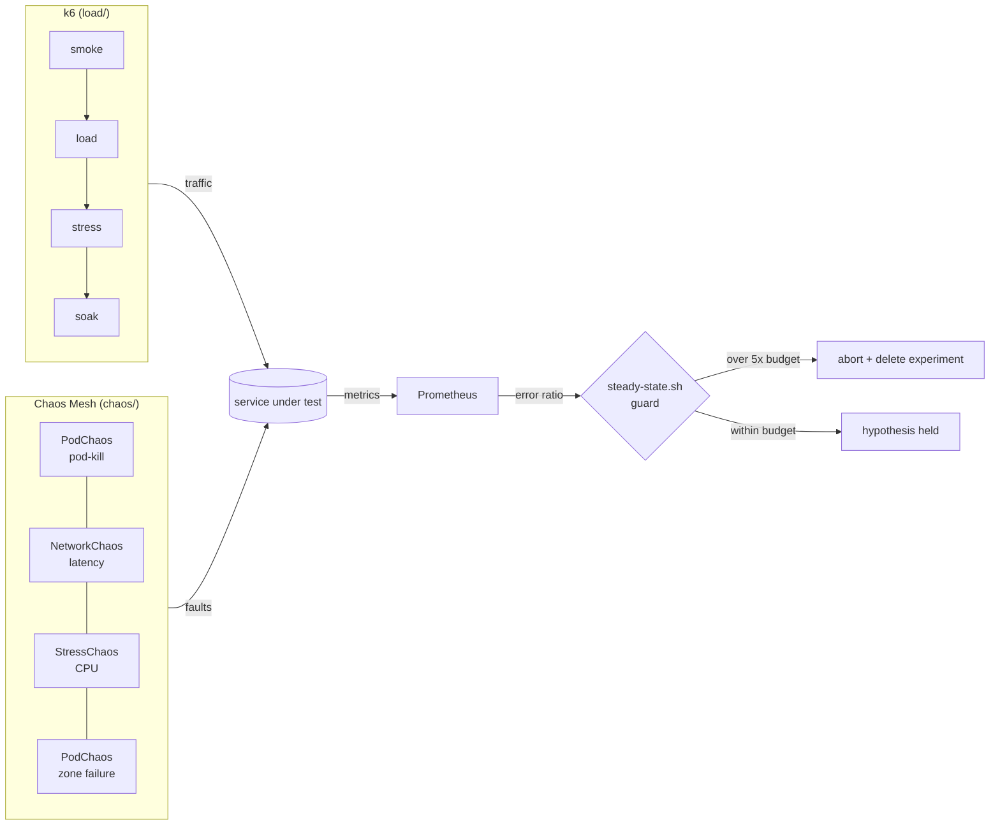

# chaos-and-load-testing

[](https://github.com/vince-sre/chaos-and-load-testing/actions/workflows/ci.yml)


A personal reference kit for **proving reliability instead of assuming it**:
SLO-gated k6 load tests, hypothesis-driven Chaos Mesh experiments, a guard
script that aborts chaos when the error budget burns, and a game day playbook.
It shows patterns I've used in production; the service names here
(`orders`, `payments`) are generic examples.



## What's here

| Path | Purpose |
|---|---|
| `load/lib/slo.js` | One place for SLO targets (99.9%, p95 < 300ms, p99 < 800ms), turned into k6 thresholds |
| `load/lib/flows.js` | Weighted shopper journey (browse, then checkout); 4xx are counted as *expected* so `http_req_failed` measures exactly what the SLO measures |
| `load/scenarios/` | `smoke` (every PR), `load` (arrival-rate peak), `stress` (step-up to the knee, with abort on fail), `soak` (hours, for leaks) |
| `target/server.py` | A stdlib-only target service with tunable latency, jitter, error rate and saturation, so the suite runs anywhere |
| `chaos/experiments/` | Pod kill, dependency latency, CPU stress, single-AZ failure; each one states its hypothesis |
| `chaos/workflows/` | A weekly `Schedule`: serial workflow of pod kill, settle, latency |
| `scripts/steady-state.sh` | Checks the steady state before chaos, polls Prometheus during it, and aborts if the error ratio exceeds 5x budget |
| `scripts/crd_to_schema.py` | Generates **strict** kubeconform schemas from the pinned Chaos Mesh CRDs (the public catalog has none) |
| `gamedays/` | Playbook (before / during / after) and a hypothesis template |

## Design decisions

- **Thresholds come from SLOs, not gut feel.** A load test passes only if the service
  would still meet its objectives at that load. Change the SLO in one file and every scenario follows.
- **Arrival-rate executors for load and stress.** Closed-model VUs slow down when the
  server does, which hides latency problems (coordinated omission). Open-model arrival
  rates keep the pressure honest; `dropped_iterations` shows when the generator itself runs out.
- **Stress aborts itself.** `abortOnFail` with `delayAbortEval` stops at the knee
  instead of hammering a shared environment.
- **Chaos is a hypothesis test.** Every manifest says what should happen and why. An
  experiment that falsifies its hypothesis is a win: the gap was found on a Tuesday afternoon, not at 3am.
- **Guardrails before blast radius.** Start with `mode: one` in staging, then all pods
  in one AZ during a staffed game day. Never start chaos on a system that's already unhealthy.
- **Strict schema validation.** Generated schemas set `additionalProperties: false`, so a
  typo like `gracePeriodd` fails CI instead of being silently ignored by the controller.

## Run it

```bash
# target service (tunable: BASE_LATENCY_MS, JITTER_MS, ERROR_RATE, SATURATION_CONCURRENCY)
PORT=8080 python3 target/server.py &

k6 run load/scenarios/smoke.js
PEAK_RPS=100 k6 run load/scenarios/load.js
ERROR_RATE=0.2 k6 run load/scenarios/smoke.js     # watch the thresholds fail (exit 99)

# everything CI runs
./scripts/validate.sh
```

Chaos (needs a cluster with Chaos Mesh installed and Prometheus reachable):

```bash
PROM_URL=http://localhost:9090 JOB=orders \
  ./scripts/steady-state.sh chaos/experiments/pod-kill.yaml 300
```

## Validation

CI ([`ci.yml`](.github/workflows/ci.yml)) runs `scripts/validate.sh`:
yamllint, shellcheck, ruff, kubeconform with strict CRD schemas, `k6 inspect` on every
scenario, and a real k6 smoke run against the local target.

## What this demonstrates

Performance engineering tied to SLOs, resilience testing with controlled blast
radius, automation that protects the system during experiments, and the human side
of reliability: game days, hypotheses and action items.

Related: [k8s-observability-stack](https://github.com/vince-sre/k8s-observability-stack) (the SLO rules and dashboards these tests are measured against) · [sre-toolkit-python](https://github.com/vince-sre/sre-toolkit-python)

## License

MIT
